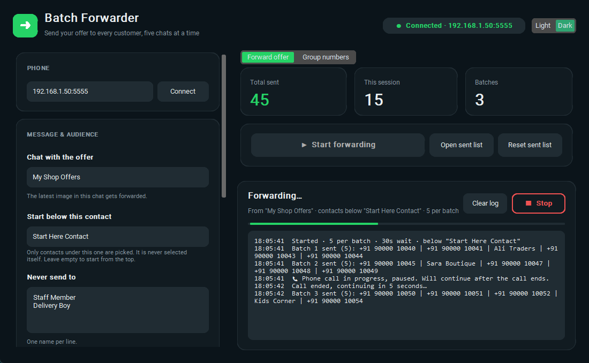
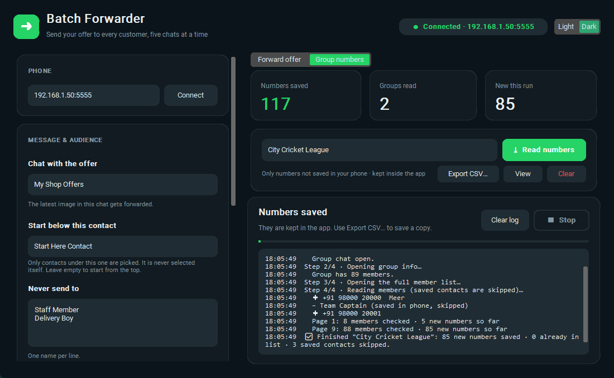
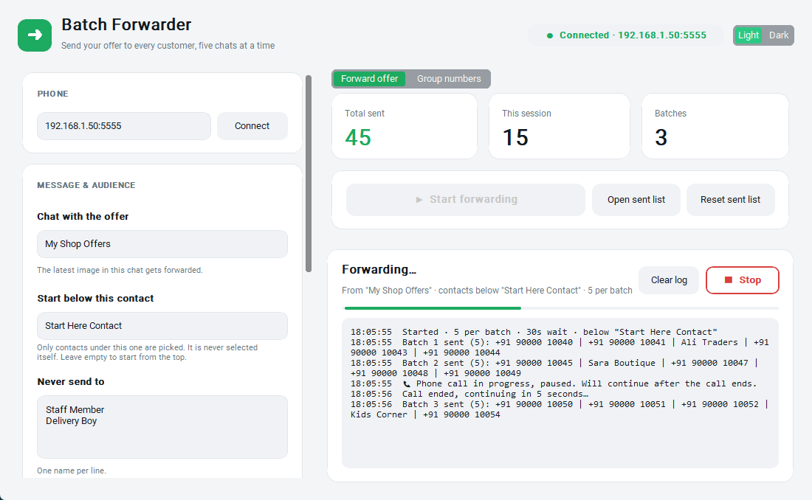

# WhatsApp Batch Forwarder

A Windows desktop app that controls your **real Android phone over ADB** to:

1. **Forward an offer** (image + caption) from one chat to your contacts, **5 chats at a time**, remembering who already got it.
2. **Collect unsaved numbers from a group**: every member who is *not* saved in your phone, kept in a list inside the app that you can export to Excel.

No AI, no WhatsApp Web, no unofficial API. It taps and reads the screen of your own phone, the same way you would.



| Group numbers tab | Light theme |
|---|---|
|  |  |

> Screenshots use demo data.

---

## How it works

```
 Windows PC                                   Android phone (USB or Wi-Fi)
┌──────────────────────────┐   adb (USB/Wi-Fi)  ┌──────────────────────────┐
│ WhatsApp Batch Forwarder │ ─── tap / swipe ──▶│ WhatsApp / WA Business   │
│  (Python + CustomTkinter)│ ◀── screen XML ─── │ (uiautomator dump)       │
└──────────────────────────┘                    └──────────────────────────┘
```

* **ADB** (Android Debug Bridge) sends taps, swipes and the back key to the phone.
* **`uiautomator dump`** returns the current screen as XML: every label, its text and position. The app finds things **by name** (contact names, the *Send* button, the member list), never by guessing coordinates.
* Everything is plain rules, so the same screen always gives the same result.

### Forward offer, one batch

1. Open the chat that contains the offer (the app finds it in the chat list, opening WhatsApp if needed).
2. Tap the **Forward** button on the latest image message.
3. In *Forward to…*, scroll down to your **start contact** and tick the next 5 contacts **below** it (never the start contact itself, never groups, never anyone in *Never send to*, never anyone already sent).
4. **Check** that the recipient bar shows exactly the ticked people, then tap **Send**.
5. Write the names to `sent.txt`, wait, repeat until the list ends.

### Group numbers

1. Open the group, then **Group info → Search members** (the full member list).
2. Scroll the list. For each member:
   * shown as a **number**, or **`~ Name` + number**: not saved in your phone, so it is **saved** to the app's list right away.
   * shown as a **name only**: saved in your phone, so it is **skipped**.
3. Duplicates are skipped across all groups. No member is ever tapped.

Works for groups where *only admins can send messages*. Community announcement groups hide the member list from non-admins, and the log says so.

### Safety built in

* **Call guard:** before every tap or swipe the app checks the phone. If it is **ringing**, or a call screen is in front, it **pauses** (so a swipe can never answer or end a call) and resumes after the call.
* **Recipient check** before every send. If it doesn't match, nothing is sent.
* **Live log** of every step, **Stop** at any time, and **Start** resumes where it stopped.
* Reset and Clear always keep a dated backup.

---

## Requirements

* Windows 10/11
* An Android phone with WhatsApp or **WhatsApp Business**
* [Android Platform Tools](https://developer.android.com/tools/releases/platform-tools) (`adb`):
  ```
  winget install Google.PlatformTools
  ```

## Set up the phone (one time)

1. **Settings → About phone →** tap **Build number** 7 times (Developer options on).
2. **Settings → Developer options →** turn on **USB debugging**.
3. Connect the phone with USB and accept *Allow USB debugging?*.
4. Optional, to work over Wi-Fi:
   ```
   adb tcpip 5555
   adb connect <phone-ip>:5555
   ```
   Find the IP in *Settings → About phone → Status*. After a phone restart, repeat this step.

## Run it

**Option A: the .exe.** Download `WhatsAppForwarder.exe` from [Releases](../../releases), put it in its own folder and double-click it.

**Option B: from source**
```
pip install -r requirements.txt
python app.py
```

**Build the .exe yourself**
```
pyinstaller --noconfirm --onefile --windowed --name WhatsAppForwarder --collect-data customtkinter app.py
```

---

## How to use

### 1. Connect
Type the phone's `IP:5555` (or leave it empty for USB) and press **Connect**. The badge at the top turns green: **● Connected**.

### 2. Forward an offer (tab *Forward offer*)

| Setting | What it does |
|---|---|
| **Chat with the offer** | Chat/group that has the offer. Its latest image is forwarded. |
| **Start below this contact** | Only contacts under this one in *Forward to…* are picked. It is never selected itself. Empty = from the top. |
| **Never send to** | One name per line (staff, family, suppliers…). |
| **Skip group chats** | On by default. |
| **Contacts per batch** | 1–5 (WhatsApp's forward limit is 5). |
| **Wait between batches** | 0–120 s. Longer looks more natural. |

1. Post the offer in your chosen chat on the phone.
2. **New offer?** Press **Reset sent list** first. **Continuing the same offer?** Don't reset, and nobody gets it twice.
3. Press **▶ Start forwarding** and don't touch the phone. Watch the counters and the live log.
4. **■ Stop** any time. **Start** continues where it stopped.

### 3. Collect group numbers (tab *Group numbers*)
1. Type the **exact** group name (same spelling as in WhatsApp).
2. Press **⤓ Read numbers**. The log shows each step and every number as it is saved (`✚`), skipped saved contacts (`–`) and duplicates (`=`).
3. **Export CSV…** saves a copy (all groups, or just the typed group) that opens in Excel. **View** opens the list. **Clear** empties it (a backup is kept).

CSV columns: `Number, Contact name, WhatsApp name, Group, Saved at`. Contact name is `Group - WhatsApp name`, or `Group 001`, `Group 002`… when WhatsApp doesn't show a name.

### Files next to the app (stay on your PC)

| File | Contents |
|---|---|
| `settings.json` | your settings |
| `sent.txt` | who already received the current offer |
| `numbers.csv` | collected group numbers |
| `sent-backup-*.txt`, `numbers-backup-*.csv` | backups made by Reset / Clear |

---

## Troubleshooting

| Problem | Fix |
|---|---|
| Badge says **Phone not found** | Same Wi-Fi? Phone restarted? Run `adb tcpip 5555` over USB again, then **Connect**. |
| *Start contact … not found* | Check the exact spelling of **Start below this contact**. |
| *Could not find a chat named …* | Use the exact chat or group name. |
| *Recipient check failed, NOT sent* | Usually the phone was touched mid-batch. Press **Start** again. |
| Rebuild says *Access is denied* | Close the app first. |

## Responsible use

This tool automates **your own** WhatsApp account on **your own** phone. WhatsApp's Terms don't allow automated or bulk messaging, and accounts that send many forwards quickly, or that people report as spam, can be **restricted or banned**.

* Only message people who know you or asked for your offers.
* Don't message strangers collected from groups. Group members didn't agree to receive marketing, and many privacy laws (e.g. India's DPDP Act, GDPR) require consent.
* Use long waits between batches.

Use at your own risk. The authors are not responsible for blocked accounts or misuse.

## Project layout

```
app.py          GUI (CustomTkinter): tabs, settings, live log
forwarder.py    ADB + screen reading, call guard, forward-in-batches engine
extractor.py    group member reader and the numbers list (numbers.csv)
docs/screenshots/
```

## License

[MIT](LICENSE)
